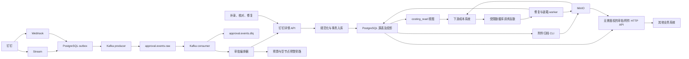

# 系统架构

**验证状态：已验证（静态代码及迁移定义）。** 实际部署拓扑待验证。

## 主数据流

证据：[主入口](../../src/index.ts)、[Stream](../../src/dingtalk/stream-listener.ts)、[Webhook](../../src/webhook/index.ts)、[outbox](../../src/kafka/event-outbox.ts)、[消费者](../../src/kafka/consumer.ts)、[编排器](../../src/normalize/orchestrator.ts)。

## 边界与事务

- HTTP 包含健康、指标、Webhook、审批人连接器和新增的审批/附件只读 API；读取 API 不执行审批写入。数据库版本化视图继续服务已有成本读取契约。新增 [读取 API](../modules/approval-read-api/README.md) 无需系统凭据，按请求企业和可选流程筛选本地源表，分页、删除标记及附件水位独立于旧视图。
- `processApprovalMessage` 记录事件、检查模板，然后调用 `refreshApprovalInstance → persistApprovalInstance`。事件日志的状态更新在审批事务之外。
- `persistApprovalInstance` 在一个 PostgreSQL 事务内写审批实例、任务及表单字段；`upsertInstance` 同步附件清单，迁移触发器维护财务投影和时间水位。字段元数据通过 SAVEPOINT 隔离单字段失败。
- 用户快照在提交后异步更新。空节点和预算检查在事件编排路径执行，异常被隔离；直接刷新/补录路径不会自动执行这两个预警。
- 附件对象 PUT 与数据库清单更新不是跨系统原子事务；通过对象标识、HEAD 恢复及 claim generation 校验收敛。详见 [附件流程](../modules/attachment-archive/workflow.md)。

## 公共能力及修改影响

| 公共实现 | 主要使用方与影响 |
| --- | --- |
| [withClient / withTransaction](../../src/db/pool.ts) | 全部 SQL；事务 client 需向下传递 |
| [api-client](../../src/dingtalk/api-client.ts)、[TokenManager](../../src/dingtalk/token-manager.ts) | 同步、归档、修复、预警；存在不同封装分支，不是每个请求都共享限流/重试 |
| [parseDingTalkTime](../../src/normalize/instance-normalizer.ts) | 实例、任务、超时计算；本项目对 Z 后缀有特定兼容处理 |
| [upsertInstance](../../src/db/queries/approval-instance.ts) | 事件、普通补录、财务补录、核对、修复；影响附件和财务触发器 |
| [attachment-extractor](../../src/archive/attachment-extractor.ts) | 表单及评论附件；与 SQL 引用计数和下载资格关联 |
| [alert-notification](../../src/db/queries/alert-notification.ts) | 三类预警的投递去重 |
| [MinIO client](../../src/archive/minio-archive.ts) | 附件与装箱快照使用同一凭据配置、不同桶配置 |

## 缓存与异步机制

Token 缓存在进程内并合并刷新请求；用户信息为 1 小时 TTL、最多 10000 项的进程内缓存。持久队列包括 outbox、财务历史窗口、审批修复、装箱刷新、附件清单及已完成审批轮转。没有发现统一任务平台或自动 DLQ 重放 worker。

[src/kafka/event-buffer.ts](../../src/kafka/event-buffer.ts) 是保留的旧实现，当前入口未引用。未配置 Kafka 时主服务能启动，但 outbox 投递无法完成；这不等于存在绕过 Kafka 的审批直写模式。可靠性限制集中见 [可靠性](reliability.md)。
