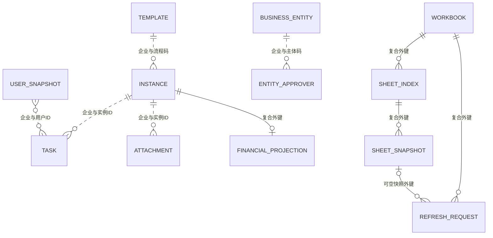

# 数据库总体设计

**验证状态：已验证（迁移及查询代码）。** 未检查实际数据库结构和迁移执行记录。

## 访问方式

PostgreSQL + `pg` 原生参数化 SQL，没有 ORM。[连接池](../../src/db/pool.ts) 从 PGHOST、PGPORT、PGUSER、PGPASSWORD、PGDATABASE 取配置，最多 20 个连接，连接超时 5 秒、空闲超时 30 秒。`withTransaction` 显式 BEGIN/COMMIT/ROLLBACK；具体隔离级别未在该函数设置。

[类型](../../src/db/types.ts) 覆盖基础归档表，扩展队列类型分散在各 queries 文件。Schema 以 [migrations](../../migrations/) 的累积结果为准，不能仅看初始迁移或 TypeScript 接口。

## 表与模型分组

| Schema / 对象 | 用途和关键约束 | 依据 |
| --- | --- | --- |
| public.ding_process_template | 企业+流程码唯一；enabled、is_deleted 相互独立 | [模板迁移](../../migrations/20260703000000_create_ding_process_template.cjs) |
| public.ding_approval_instance / ding_approval_task | 实例企业+实例 ID 唯一；任务企业+实例 ID+任务 ID 唯一；基础迁移未声明二者外键 | [实例](../../migrations/20260703000001_create_ding_approval_instance.cjs)、[任务](../../migrations/20260703000002_create_ding_approval_task.cjs) |
| public.ding_form_field | 企业+模板+字段 ID 唯一，保存字段元数据而非实例明细台账 | [字段迁移](../../migrations/20260703000004_create_ding_form_field.cjs) |
| public.ding_user_departure | 已通过的离职审批及身份核对结果；企业+来源实例为主键及外键，限制硬删除来源实例，按企业+人员+日期查询已生效记录 | [离职迁移](../../migrations/20261111000000_create_ding_user_departure.cjs) |
| public.ding_user_snapshot / ding_department_tree | 人员成功资料版本及当前标志、部门父子与 JSONB 路径；快照 current 按企业+用户部分唯一且必须成功、valid_to 为空；union_id 由后续迁移加入 | [用户](../../migrations/20260703000003_create_ding_user_snapshot.cjs)、[当前唯一与失败分离](../../migrations/20261110000000_separate_user_fetch_failures.cjs)、[部门](../../migrations/20260722000000_create_ding_department_tree.cjs)、[unionId](../../migrations/20260914000000_add_union_id_to_user_snapshot.cjs) |
| public.ding_user_fetch_failure | 独立失败历史及次数；source_snapshot_id 唯一标识迁移前失败来源，清理后 source_snapshot_payload 保存完整原行 JSON；最近错误按企业+用户+时间索引查询，无 current 语义 | [失败分离](../../migrations/20261110000000_separate_user_fetch_failures.cjs)、[旧失败清理](../../migrations/20261110000002_purge_legacy_failed_user_snapshots.cjs)、[人员规则](../modules/metadata-organization/README.md#用户快照与失败记录) |
| public.ding_corp_config | 已知活跃企业；主进程还会确保表存在 | [迁移](../../migrations/20260703000007_create_ding_corp_config.cjs)、[查询](../../src/db/queries/corp-config.ts) |
| public.ding_event_log / ding_event_outbox | 处理审计与可靠投递分离；日志 event_id 非空时企业内去重，outbox 企业+事件 ID 唯一 | [日志](../../migrations/20260703000006_create_ding_event_log.cjs)、[outbox](../../migrations/20260806000001_create_ding_event_outbox.cjs) |
| public.backfill_cursor | 企业+模板+起止窗口唯一；普通补录计数 | [游标迁移](../../migrations/20260703000005_create_backfill_cursor.cjs) |
| public.ding_business_entity / ding_business_entity_approver | 企业内主体码唯一、主体+人员映射唯一；代码逻辑关联 | [主体迁移](../../migrations/20260805000000_create_business_entity_approver.cjs) |
| public.ding_alert_notification | 企业+实例+预警类型+阶段+接收人唯一 | [预警迁移](../../migrations/20260915000000_create_ding_alert_notification.cjs) |
| costing_read.allowed_process_template | 原有主键只有 process_code；手工白名单与自动注册的范围不同 | [基础归档](../../migrations/1788492000000_create_costing_archive.cjs)、[采购范围](../../migrations/20260910000000_purchase_template_scope.cjs) |
| costing_read.attachment_archive / dingtalk_api_usage / archive_sync_health | 附件三元唯一键、桶对象键唯一；API 调用记录；归档批次状态 | [基础归档](../../migrations/1788492000000_create_costing_archive.cjs)、[诊断扩展](../../migrations/1788505200000_add_archive_diagnostics.cjs) |
| costing_read.approval_repair_request / completed_approval_refresh | 修复请求与已完成实例轮转；前者有白名单流程外键，后者企业+实例主键 | [修复](../../migrations/1788856369000_create_approval_repair_queue.cjs)、[轮转](../../migrations/20260909000000_logistics_settlement_archive.cjs) |
| costing_read.purchase_template_scope / purchase_approval_exposure | 企业内采购模板范围及实例首次暴露时间 | [采购范围](../../migrations/20260910000000_purchase_template_scope.cjs) |
| costing_read.financial_template_scope / financial_source_exposure / financial_template_discovery / financial_backfill_window | 财务模板、来源、名称发现及可恢复窗口 | [财务范围](../../migrations/20260910010000_financial_source_scope.cjs) |
| costing_read.financial_source_projection | 运输证据、关联实例、附件引用数；企业+实例外键到源实例，ON DELETE CASCADE | [财务投影](../../migrations/20260910020000_financial_source_projection.cjs) |
| costing_read.allowed_packing_workbook / packing_sheet_index / packing_sheet_snapshot / packing_refresh_request | 允许工作簿、工作表索引、快照、刷新任务；显式复合外键及约束 | [装箱迁移](../../migrations/20260907000000_create_packing_sheet_cache.cjs) |

## 核心实体关系

虚线为业务关联，实线为上述迁移确认的外键；图只表达核心关系，并非完整数据库 ER。

## 一致性、索引与扩展约束

- 基础表主要使用 BIGSERIAL 技术主键、VARCHAR 业务 ID、TIMESTAMPTZ、JSONB。审批金额保留在源表单 JSON，未发现统一金额台账或币种模型；预算预警计算使用 JavaScript number。不要把所有金额描述为数据库精确定点数。
- 基础实例有表单 JSONB GIN、状态/企业、创建时间索引；[增量索引迁移](../../migrations/20260730000000_add_approval_instance_updated_at_index.cjs) 和财务投影关联 ID GIN 支撑后续查询。实际查询计划和数据规模待验证。
- [HTTP 读取索引迁移](../../migrations/20261029000000_approval_read_api_indexes.cjs) 为实例和附件清单补充企业+更新时间+稳定 ID 索引，包含删除/退役记录，供 [只读 API](../modules/approval-read-api/README.md) 游标分页使用。此迁移文件已准备，未应用到生产，真实查询计划待验证。
- 事务、租约、代次校验因队列而异，见 [可靠性矩阵](reliability.md)。核心字段与水位见 [数据字典](data-dictionary.md)。
- 多数归档表有 corp_id，但没有发现数据库 RLS。白名单旧表仅按流程码，自动采购/财务范围额外按企业约束；不得宣称全部唯一键都含 corp_id。
- v1/v2 视图是下游兼容接口。变更列名、顺序、类型、删除标记或水位必须检查后续迁移重定义、查询及下游调用。

## 迁移约定

迁移文件为 node-pg-migrate CJS；仓库同时存在不同长度数字前缀。归档迁移引用基础表，集成测试用显式依赖顺序和 checkOrder:false。不得把文件名排序等同于已验证的空库安装顺序。

依赖链概括：基础归档表 → 成本归档/诊断/人员名/修复 → 物流结算 v2 → 采购范围 → 财务范围 → 财务投影。装箱、预警、时间修正另有迁移。具体顺序参考 [财务集成测试](../../src/db/financial-contract.integration.test.ts) 和既有专项文档，部署数据库状态仍待验证。

财务范围与投影的 down 明确抛错以保留审计证据。时间修正迁移会改历史数据，不能作为文档检查执行。迁移、回滚、角色配置必须在获准的独立实施任务中处理。

用户失败分离采用 [第一阶段](../../migrations/20261110000000_separate_user_fetch_failures.cjs) 复制失败历史、按下一成功版本生效时间修复重叠区间、恢复最后成功资料，并添加唯一索引及 NOT VALID CHECK；[第二阶段](../../migrations/20261110000001_validate_user_snapshot_current.cjs) 打断迁移器合并事务后独立校验 CHECK。两阶段均限制锁等待 5 秒、单语句 5 分钟。第一阶段添加约束仍会短暂阻塞读取，须安排读写维护窗口；第二阶段失败不回滚第一阶段，排查后可重试校验。原行保留，两阶段均拒绝自动 down。本次未执行，完整步骤见 [人员迁移说明](../modules/metadata-organization/README.md#用户快照与失败记录)。

[独立清理阶段](../../migrations/20261110000002_purge_legacy_failed_user_snapshots.cjs) 要求前置 CHECK 已校验，逐行核对失败归档与引用关系，将旧失败原行完整保存到失败表的 source_snapshot_payload 后才从快照表删除；保留所有成功版本及失败次数，不更改前两阶段。任何归档缺失、错配、入站外键或自定义触发器/规则均中止，整体事务回滚；down 拒绝自动恢复。生产执行需要独立授权、备份和读写维护窗口；只准备代码不代表已清理。精确按名称预览及验证步骤见 [清理说明](../modules/metadata-organization/README.md#旧失败快照的独立清理)。
