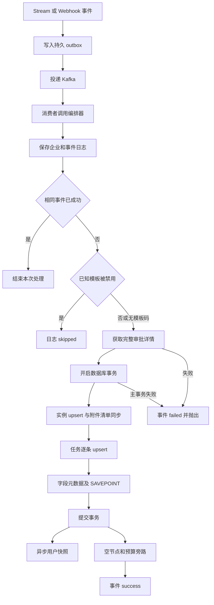

# 审批处理流程

[模块概况](README.md) · [可靠性边界](../../knowledge/reliability.md)

**验证状态：已验证（静态调用）。**

证据：[编排器](../../../src/normalize/orchestrator.ts)、[实例写入](../../../src/db/queries/approval-instance.ts)、[字段保存点](../../../src/normalize/form-field-extractor.ts)。图中的 API 失败与主事务失败是异常路径，不表示预警异常会回滚。

## 事务与重放

outbox 保存、Kafka 投递、事件日志状态、详情事务、用户快照、外部通知分属不同操作边界。写入详情后、日志成功前崩溃可重放；依赖 upsert、清单差异判断和预警去重控制副作用，不能称全链路 exactly-once。

消费者解析 JSON 在业务重试循环外。业务处理失败尝试 3 次后写 approval.events.dlq，再提交 offset；没有发现自动消费 DLQ 的实现。修复方式应结合 [恢复模块](../approval-recovery/README.md)，不能认为失败队列会自行完成历史补齐。
