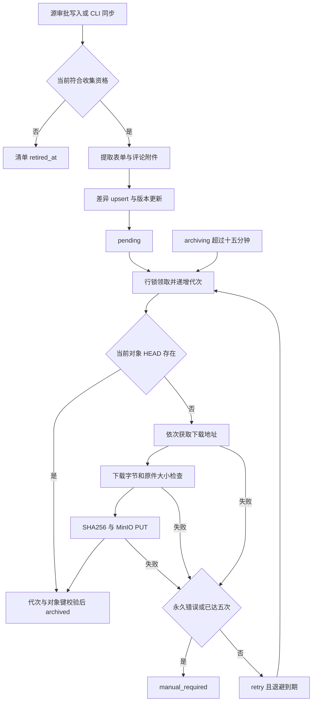

# 附件状态与恢复流程

[模块概况](README.md) · [财务资格规则](../financial-sources/README.md)

**验证状态：已验证（静态实现）。**

代码依据：[archive-job](../../../src/archive/archive-job.ts)、[查询](../../../src/db/queries/attachment-archive.ts)、[CLI](../../../src/cli/archive-attachments.ts)、[版本触发器](../../../migrations/20260909000000_logistics_settlement_archive.cjs)。

## 与状态枚举正交的维度

- retired_at 表示此清单不再活跃，不是 archive_status 的新值。
- content_quality=original/preview 表示内容质量，不因状态 archived 自动变成 original。
- revision_generation 和 claim_generation 控制源版本及领取代次，旧 worker 即使上传完也不能覆盖当前清单。
- MinIO 上传成功而数据库写回失败不等于业务完成；恢复依赖当前对象键、HEAD 与有效领取条件，不能仅根据批次退出码判断所有历史附件可用。
- 预览与原件的不同领取对象键防止旧任务延迟上传覆盖已发布原件；未引用历史对象的生命周期清理未在本次分析中证明已实现。
