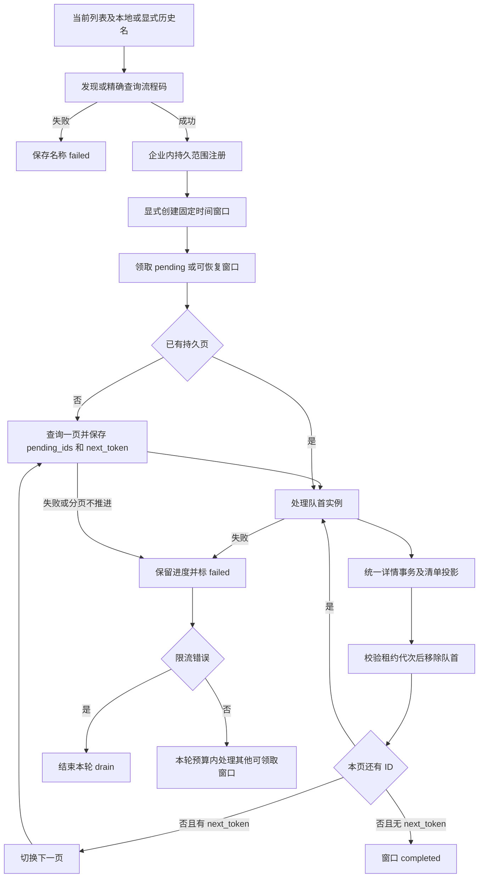

# 财务来源发现与恢复流程

[模块概况](README.md)

**验证状态：已验证（静态代码）。**

依据：[发现](../../../src/jobs/financial-template-discovery.ts)、[脚本排期](../../../scripts/financial-backfill.ts)、[worker](../../../src/jobs/financial-backfill.ts)、[领取和写回](../../../src/db/queries/financial-backfill.ts)。

## 失败语义与边界

失败窗口至少等待约 1 分钟，且同一次 invocation 不立即重新领取刚失败窗口。更新进度必须匹配 generation、running 及有效租约；丢失租约时不继续推进。成功写详情后、确认进度前崩溃会重放同一实例，不会将失败 ID 当作完成。

completed 只表示该窗口搜索返回的全部页和 ID 都处理完成；不能证明未被发现的模板或上游未返回记录不存在。附件下载独立执行；窗口完成不等于附件已下载，也不等于财务入账完成。
