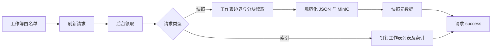

# 装箱工作簿快照

[返回知识库](../../knowledge/README.md)

**验证状态：已验证（静态代码）。** 下游通过数据库请求刷新和读取快照，没有单独 HTTP 路由或前端。

## 业务与数据流程

配置 DINGTALK_PACKING_WORKBOOKS_JSON 定义 year/workbookId/label，JSON 校验限制年份 2000–2200，同配置不能重复年份或 ID。[同步 CLI](../../../src/cli/sync-packing-workbooks.ts) 同步允许工作簿并入队索引刷新；数据库同步会停用本企业配置以外的工作簿，不是只读操作。

请求分 workbook_index 和 sheet_snapshot。前者读取工作表列表，事务替换索引并为消失工作表设置 deleted_at；后者只读取启用且当前可见的工作表，通过 reader userId 获取 unionId，以 operatorId 请求钉钉文档 API。

读取使用 lastNonEmptyRow/Column 的零基边界构造 A1 范围；两者均 -1 表示空表，只有一项负数则拒绝。范围超过配置上限拒绝；按最大单次单元格数量分块保存 values、displayValues、formulas，不推测合并单元格。

依据：[worker](../../../src/packing/refresh-worker.ts)、[document-client](../../../src/dingtalk/document-client.ts)、[snapshot-store](../../../src/packing/snapshot-store.ts)。

## 数据库及接口

全部在 costing_read，定义见 [装箱迁移](../../../migrations/20260907000000_create_packing_sheet_cache.cjs)。

| 对象 | 核心关系与约束 |
| --- | --- |
| allowed_packing_workbook | 企业+工作簿主键；启用时企业+年份唯一 |
| packing_sheet_index | 企业+工作簿+工作表主键，关联白名单工作簿 |
| packing_sheet_snapshot | 工作表复合外键；企业+工作簿+工作表+content_sha256 唯一，bucket/object_key 唯一 |
| packing_refresh_request | request_key 唯一；请求类型约束 sheet_id 可空性；可关联 snapshot_id |
| packing_workbooks_v1 / packing_sheet_index_v1 / packing_sheet_snapshots_v1 / packing_refresh_status_v1 | 下游读取契约 |
| request_packing_workbook_index_refresh(workbook_id, request_key, requested_by) | 返回请求 bigint ID |
| request_packing_sheet_refresh(workbook_id, sheet_id, request_key, requested_by) | 返回请求 bigint ID |

请求函数 SECURITY DEFINER、显式 search_path，验证请求 key 及 requested_by、白名单，重复 key 返回原请求。企业从白名单推导，不从可信登录会话获得，跨企业调用权限见 [认证](../../knowledge/authentication.md)。

## 快照与恢复边界

- 快照 schemaVersion=1、mergeRangesAvailable=false；保存 captureStartedAt/captureFinishedAt，capture_consistency 为 single_range 或 multi_range，不能保证多块是同一时刻。
- JSON 递归排序对象键后计算 SHA-256，内容寻址对象并用 HEAD 校验大小/摘要。摘要包含采集时间，不能称为纯单元格内容去重。
- MinIO 写入、数据库快照插入、请求状态更新分步执行，没有分布式事务。
- [SQL 队列](../../../src/db/queries/packing-workbook.ts) 使用 SKIP LOCKED、15 分钟超时重领、最多 3 次领取；可重试失败回 pending，否则 failed。结果写回按 id，没有代次校验。
- worker 进程内防重叠。配置缺 reader 时标失败；unionId Promise 拒绝后未重置的恢复限制见 [可靠性](../../knowledge/reliability.md)。
- 默认最大 5000 行、100 列、单次 5000 单元格；配置范围以 schema 为准。

测试：[worker](../../../src/packing/refresh-worker.test.ts)、[存储](../../../src/packing/snapshot-store.test.ts)、[文档 API](../../../src/dingtalk/document-client.test.ts)、[迁移检查](../../../src/db/queries/packing-workbook.test.ts)。本次未运行；真实工作簿权限、读取期间变动、快照大小和队列状态待验证。
